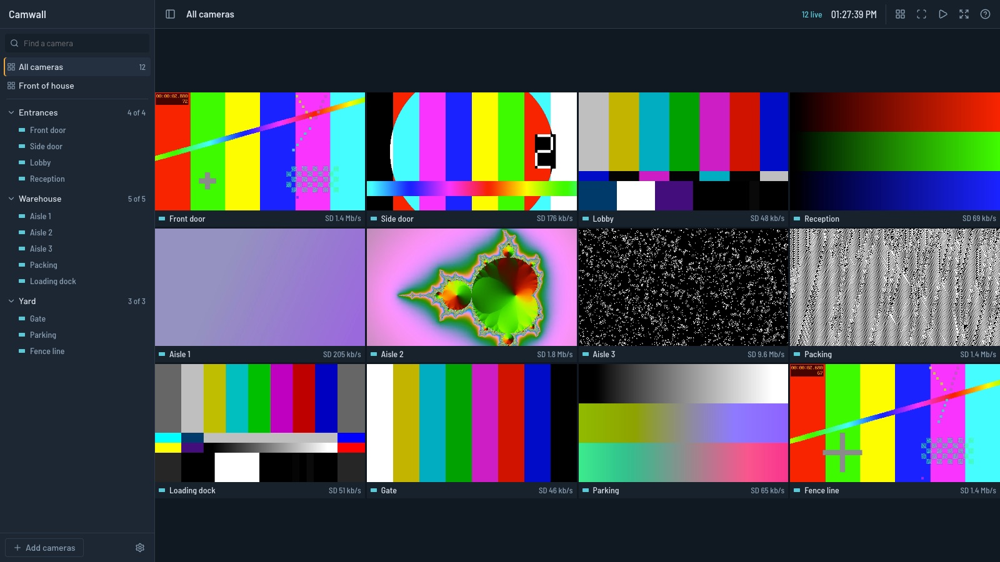
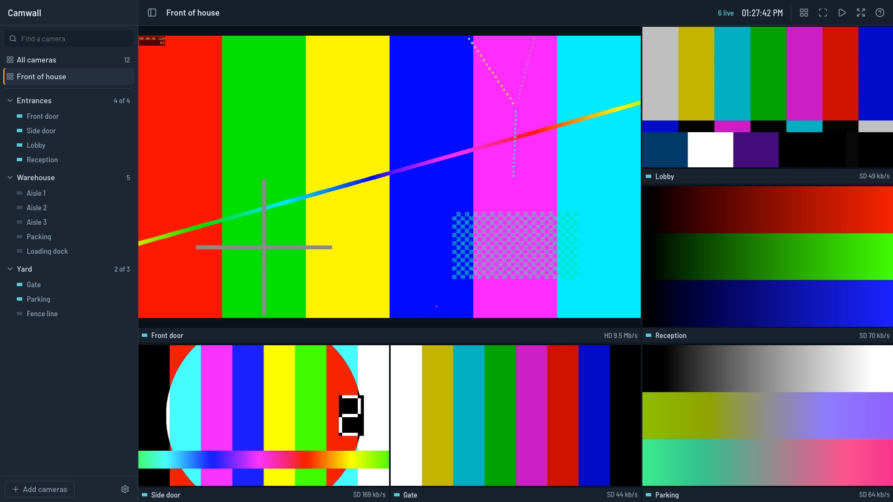

# Camwall

A browser video wall for RTSP cameras and recorders. Point it at a DVR, and every channel plays live in one page, arranged however you want.



Most recorders ship a Windows client or a plugin that stopped working years ago. Camwall needs a browser. It runs next to the recorder in two containers, and anything that can reach the page can watch: a desktop, a TV stick, a phone.

## What it does

- **Layouts.** Eleven of them, from one tile to 25, including large-plus-small arrangements. Auto picks the column count that makes tiles largest in the current window. Cameras that don't fit a layout go on further pages.
- **Groups.** File cameras under names like Parking or Warehouse. Each group opens as its own wall. Drag a camera onto a group to refile it.
- **Saved views.** Drag cameras onto tiles, swap tiles, then save the arrangement under a name. Links keep the view, so `?view=group:yard` makes a good kiosk bookmark.
- **Tour.** Steps through pages and views every 5 to 60 seconds.
- **Two streams per camera.** Tiles use the recorder's small stream. The largest tiles and full view switch to the big one, four at most, and you can force either per tile.
- **Find cameras over ONVIF.** Enter a recorder's address and tick the channels you want. Pasting an RTSP address works too.
- **Bandwidth care.** Only tiles on screen pull video, a hidden tab pulls nothing, and streams open four at a time so a slow recorder isn't hit with every channel at once.
- **Playback.** Plays a recorder's own archive at full quality, with a calendar, a timeline of what was recorded, speeds to 8x, and a keystroke to follow the same moment onto the next camera. See [Playback](#playback) for the recorders it knows.
- **Phones.** The camera list becomes a drawer and the wall scrolls in two columns.
- **Right-click menus.** Every tile, camera, group, view and bar has one, and it changes with what you clicked: a lost camera leads with reconnecting, an empty tile lists what the wall is missing, and a camera's menu holds a small copy of the wall with live frames, so you can press the tile it should go on. Hold a finger down on a phone. Shift + right click gets the browser's own menu.



Press `?` in the app for the keyboard shortcuts.

Camwall doesn't record anything itself, and it has no motion detection or audio.

## Try it with test patterns

You need Docker. This starts twelve fake cameras, with no hardware involved:

```sh
docker compose -f compose.yaml -f compose.demo.yaml up --build
```

Open http://127.0.0.1:8090.

## Run it with your cameras

```sh
docker compose up -d --build
```

Open http://127.0.0.1:8090 and choose Add cameras. Set `CAMWALL_PORT` to use another port.

To write the config by hand instead, start from `config.example.json` and place it at `/data/config.json` in the `camwall` container. A camera's `sub` is its low resolution stream. Leave it `null` if the camera has only one.

The host running Camwall must be able to reach the cameras' RTSP port. Streams must be H.264, because that is what browsers play through Media Source Extensions.

| Variable                  | Default              | Meaning                                                                                               |
| ------------------------- | -------------------- | ----------------------------------------------------------------------------------------------------- |
| `CAMWALL_PORT`            | `8090`               | Port on the host, in `compose.yaml`                                                                   |
| `CAMWALL_ALLOWED_ORIGINS` | empty                | Comma-separated origins allowed besides the page's own host, for a reverse proxy that rewrites `Host` |
| `CAMWALL_DATA`            | `/data`              | Where `config.json` lives                                                                             |
| `GO2RTC_URL`              | `http://go2rtc:1984` | The go2rtc API                                                                                        |

## Playback

Camwall plays footage that already sits on a recorder. It speaks the private protocol of Unix CCTV and Eyemax Magic recorders, the ones the CMS desktop client talks to on port 8780. Other brands have live view only.

Open Settings, then Recorders, and add the recorder's address. Camwall logs in to check it, then links every camera whose stream comes from that address, reading the channel from paths like `mainStream6`.

Once a camera is linked, a Live and Playback switch appears in the top bar. Playback works on the wall you have open, the way live does: same layout, same pages, and every tile with a recorder plays the same moment under one timeline. The recorder plays all of them on one clock, the way its own client does, so they stay in step. A recorder plays one quality at a time, so four or fewer big tiles get HD and anything more gets SD. The quality chip can force either. A tile with nothing recorded at that moment dims and says so. On a phone only the tiles on screen play, and a scroll or a page change brings new ones in at the same moment while the rest keep playing.

Double click a tile, or select it and press `Enter`, to watch that camera alone at the same moment. `[` and `]` then step through the wall's cameras, and `Esc` goes back to the wall. Picking a camera in the list opens it the same way, and picking a view keeps playback on and shows that view. From live, `P` plays back the wall, or the camera in full view, and a tile's clock button plays back that one camera. Cameras with no recorder are dimmed in the list, and a right click on the footage holds the controls.

Copy link to this moment gives an address that opens there: `?view=group:yard&replay=&at=2026-11-06T10:05:00` for a wall, or `?replay=gate&at=2026-11-06T10:05:00` for one camera.

| Key                   | Does                                                         |
| --------------------- | ------------------------------------------------------------ |
| `Space`               | Play or pause                                                |
| `Left`, `Right`       | Back or forward 10 seconds                                   |
| `Enter`, double click | Open the selected tile alone, same moment                    |
| `[`, `]`              | Previous or next page, or for one camera the next camera     |
| `S`                   | Save a snapshot of the selected tile                         |
| `Esc`                 | From one camera back to the wall, from the wall back to live |
| `P`                   | Back to live                                                 |

In `config.json` a recorder goes in `recorders`, and a camera points at it with `"replay": { "recorder": "<id>", "channel": 6 }`. Set `replay` by hand when a camera's stream doesn't name its channel.

What to expect:

- It is tested on one model, the Magic-U 4M 32. Password login follows the vendor client's scheme but hasn't been tried, so open an issue if it fails.
- A wall plays up to 32 cameras from one recorder connection. Cameras on different recorders each get their own, and those clocks are only as close as the recorders' own. It doesn't play in reverse or export clips.
- Gaps in a motion-recorded channel are skipped, not played. Footage from the last few seconds isn't readable yet, so a replay that catches up with the present stops there until you press play again.
- Speed depends on the link. 8x on the big stream needs about 22 Mbit/s from the recorder to the viewer. Switch to SD if the picture keeps waiting.

## Security

**Camwall has no login.** Anyone who reaches the page can watch every camera, browse every recording the recorder still holds, and change the setup. The compose file binds to `127.0.0.1` for that reason. To share it, put it behind a VPN such as Tailscale, or behind a reverse proxy that does authentication. Don't publish it to the internet as it stands.

What it does protect:

- go2rtc has no published port, because its API can run commands. Only the Camwall server talks to it.
- Browsers name a camera and a quality, never a stream source. The server maps that to a go2rtc stream, and it forwards nothing from the browser except the codec list.
- New cameras must be `rtsp://` or `rtsps://` addresses. `exec:`, `ffmpeg:` and `#` options are refused, in the API and in `config.json`.
- Stream addresses, which can hold passwords, never reach the browser. They sit in `config.json` with mode 600, and go2rtc keeps its own copy in its config volume.
- Writes and video sockets from another site's page are refused by an Origin check.
- Recorder addresses and passwords stay in `config.json` too. The browser only sees a recorder's name. The recorder's protocol has no encryption and hides its password behind a fixed XOR key, so keep Camwall and the recorder on the same trusted network.
- Camwall only reads from a recorder. It sends no command that changes or deletes footage.

## How it works

```
browser ── /ws/:camera/:quality ──> camwall (Bun) ──> go2rtc ── RTSP ──> recorder
        <── fragmented MP4 ───────
```

Playback skips go2rtc:

```
browser ── /ws/replay/:camera/:quality ──> camwall (Bun) ── port 8780 ──> recorder
        <── fragmented MP4 ──────────────
```

go2rtc pulls each stream once, however many people watch, and repackages H.264 as fragmented MP4 with no transcoding. The browser feeds that into Media Source Extensions and keeps playback within about 2.5 seconds of live. The server syncs go2rtc's stream list from `config.json` on start, on every change, and every 15 seconds.

For playback, the server opens one recorder connection per viewer. The recorder only moves forward when asked, so the server asks until it holds six seconds of video ahead of the viewer, then waits. It wraps each H.264 frame in MP4 without transcoding and stamps it with the time of day, so the browser's clock and the timeline agree.

## Development

Uses [Bun](https://bun.sh). Start go2rtc somewhere, then:

```sh
bun install
GO2RTC_URL=http://127.0.0.1:1984 bun run dev   # app on :5173, API on :8090
bun run typecheck && bun run lint && bun run test && bun run build
```

`bun run e2e` drives the demo stack in Chrome and needs Node and a local Chrome.

## License

MIT
